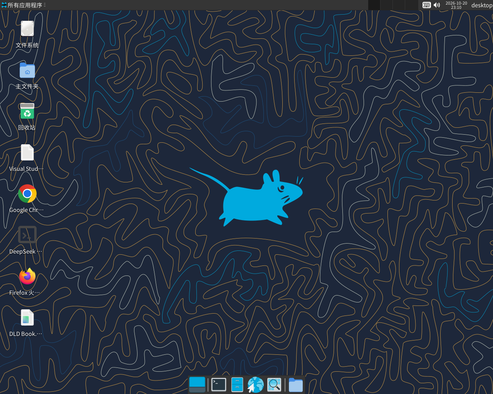

# 02 · 架构、目录约定与脚本



*2026-10-20 的 `gpu-test` 窗口截图（`evidence/2026-10-20-XFCE.png`），当时 XFCE 与 VNC 服务在运行。*

---

## 1. 三层结构

```text
┌──────────────────────────── Android ────────────────────────────┐
│  Termux (com.termux)                                            │
│   ├─ virgl_test_server_android --angle-vulkan                   │
│   │     └─ ANGLE Vulkan → 原厂 Vulkan loader/驱动 → Mali-G925   │
│   └─ termux-x11 :8 -tag gpu-test -extension MIT-SHM             │
│           ▲  X11 协议                                          │
│           │                                                     │
│  ┌────────┴───────── PRoot: ubuntu 容器 ──────────────────────┐  │
│  │  Ubuntu 24.04.5 ARM64                                     │  │
│  │   ├─ XFCE 4.18（xfwm4 合成关闭）                          │  │
│  │   └─ glmark2 / glxgears                                   │  │
│  │        └─ GALLIUM_DRIVER=virpipe                          │  │
│  │           VTEST_SOCKET_NAME=/tmp/y900-gpu-vtest           │  │
│  └───────────────────────────────────────────────────────────┘  │
│         Unix socket 经 --shared-tmp 在两边同名可见                │
└─────────────────────────────────────────────────────────────────┘
```

两条独立通道，缺一不可：

| 通道 | 承载 | 关键参数 |
|---|---|---|
| VirGL / VTEST Unix socket | OpenGL 绘图命令与渲染结果 | `GALLIUM_DRIVER=virpipe`、`VTEST_SOCKET_NAME`、`--shared-tmp` |
| X11 socket | 窗口、输入、显示 | `DISPLAY=:8`、`termux-x11`、`-extension MIT-SHM` |

**`DISPLAY=:8` 只说明显示接上了，不说明 GPU 生效。** 是否真的走 Mali，必须看测试程序的 `GL_RENDERER`。

---

## 2. 脚本对照表

### Termux 侧（安装到 `$PREFIX/bin`）

| 文件 | 作用 | 关键行为 |
|---|---|---|
| `scripts/termux/ubuntu-manager` | 唯一基线管理器（Python） | `start` / `connect` / `status` / `stop` / `restart` / `logs` / `shell` / `gpu-shell` / `run` / `software` / `test` / `size` |
| `scripts/termux/ubuntu-gpu` | 兼容入口 | `ubuntu-gpu shell` → `ubuntu-manager gpu-shell`；其余原样转发 |
| `scripts/termux/ubuntu-xfce-gpu` | 兼容入口 | 同上 |
| `scripts/termux/ubuntu-desktop` | 兼容入口 | 等价 `ubuntu-manager start` |
| `scripts/termux/ubuntu-stop` | 兼容入口 | 等价 `ubuntu-manager stop` |

`ubuntu-manager start` 的实际动作：

1. 若 VirGL 进程不存在，启动
   `virgl_test_server_android --angle-vulkan --socket-path "$TMPDIR/y900-gpu-vtest"`；
2. 若 `:8` 不可用（`xdpyinfo` 失败），启动
   `termux-x11 :8 -tag gpu-test -extension MIT-SHM`；
3. 最多等 15 秒，确认 VirGL PID、socket 文件、X11 三者就绪；
4. 启动或检查 PulseAudio，并加载 `module-native-protocol-tcp`（仅 `127.0.0.1:4713`）；
5. 若还没有 `xfce4-session`，在容器内以 `desktop` 用户执行 `start-tablet-gpu`，并记录 `session.json`（PID + start time 用于防误杀）；
6. 调起 Android 的 Termux:X11 到 `gpu-test` 窗口。

`ubuntu-manager stop` 只结束 `/proc` 中 `cmdline` 以 `termux-x11 com.termux.x11 :8 -tag gpu-test` 开头的进程，以及 PID 文件里校验过命令行的 VirGL 进程；**不会全局 `killall`，也不会杀其他显示或所有 PRoot 进程**。

### Ubuntu 侧（安装到容器 `/usr/local/bin`）

| 文件 | 作用 |
|---|---|
| `scripts/ubuntu/start-tablet-gpu` | 设置 `DISPLAY=:8`、`XDG_*`、输入法、PulseAudio、`GALLIUM_DRIVER=virpipe`、`VTEST_SOCKET_NAME`；清掉 `LIBGL_ALWAYS_SOFTWARE` 与各种 `MESA_*` override；准备独立配置/缓存目录；`dbus-run-session` 内关闭 xfwm4 合成、改轮廓移动/缩放、关闭会话保存，最后 `exec xfce4-session --disable-tcp` |
| `scripts/ubuntu/y900-live-session` | 从 `/proc` 找到 `DISPLAY=:8` 的 `xfce4-session`，把它的 `DBUS_SESSION_BUS_ADDRESS`、`XDG_RUNTIME_DIR`、`PULSE_SERVER`、GPU 变量等导入当前进程，再 `execvp` 目标程序；用于经 SSH 启动图形程序 |

`start-tablet-gpu` 的配置隔离策略：

- `XDG_CONFIG_HOME=$HOME/.config/y900-xfce-gpu`
- `XDG_CACHE_HOME=$HOME/.cache/y900-xfce-gpu`
- `XDG_RUNTIME_DIR=/tmp/runtime-y900-xfce-gpu`（`0700`）
- 首次运行从 `~/.config` 复制 `xfce4`、`gtk-3.0`、`fcitx5`、`mimeapps.list`、`user-dirs.*`、`autostart/fcitx5.desktop`
- 写入 `autostart/tracker-miner-fs-3.desktop`（`Hidden=true`）禁用该桌面的 Tracker

**XFCE 的二维界面本身不等于整个桌面使用 OpenGL 合成**：该基线明确关闭 xfwm4 合成，移动/缩放用轮廓以减少重绘。

### 辅助脚本（仓库根 `scripts/`）

| 文件 | 运行位置 | 说明 |
|---|---|---|
| `restore-x11-baseline.sh` | 普通 Termux | 校验 `PREFIX`、容器 `desktop` HOME、依赖命令、XFCE 未运行、容器内关键命令存在；备份后安装 `scripts/termux/*`、`scripts/ubuntu/*`、`config/xfconf/*.xml`；再生成 `~/xfce/{start,connect,stop,restart,status,logs}.sh` 转发脚本。**不启动任何服务。** |
| `prepare-ubuntu.sh` | 容器内管理员 | 可选的新镜像依赖准备：`apt-get install` XFCE、`dbus-x11`、`x11-utils`、`x11-xserver-utils`、`mesa-utils`、`glmark2-x11`、`libgl1-mesa-dri`、CJK 字体、`fcitx5` 等；创建/校验 `desktop` 用户与 UID；`locale-gen`；写 fcitx5 自启动 |
| `run-gpu-test.sh` | 普通 Termux | `smoke` = 45s 限时三场景 glmark2；`gears` = 交互式 glxgears；`compare` = 先软件后 GPU 各跑一次 glmark2 |

---

## 3. 环境变量

`start-tablet-gpu` 导出的核心变量：

```sh
DISPLAY=:8
GALLIUM_DRIVER=virpipe
VTEST_SOCKET_NAME=/tmp/y900-gpu-vtest
PULSE_SERVER=tcp:127.0.0.1:4713
XDG_CONFIG_HOME=$HOME/.config/y900-xfce-gpu
XDG_CACHE_HOME=$HOME/.cache/y900-xfce-gpu
XDG_RUNTIME_DIR=/tmp/runtime-y900-xfce-gpu
LANG=zh_CN.UTF-8
GTK_IM_MODULE=fcitx  QT_IM_MODULE=fcitx  XMODIFIERS=@im=fcitx
```

同时显式清除可能破坏硬件路径的变量：

```sh
LIBGL_ALWAYS_SOFTWARE
MESA_GL_VERSION_OVERRIDE
MESA_GLSL_VERSION_OVERRIDE
MESA_LOADER_DRIVER_OVERRIDE
```

`ubuntu-manager run` / `gpu-shell` 会从运行中的 `xfce4-session` 读取这些变量再注入子进程，避免「新开的 shell 没有 GPU」的常见问题。

---

## 4. 配置文件

`config/xfconf/` 是归档时选定的三个 XFCE 配置，恢复脚本会安装到：

```text
$ROOTFS/home/desktop/.config/y900-xfce-gpu/xfce4/xfconf/xfce-perchannel-xml/
```

| 文件 | 内容要点 |
|---|---|
| `xfwm4.xml` | 窗口管理器行为：合成关闭、轮廓移动/缩放、工作区设置 |
| `xfce4-session.xml` | `SaveOnExit=false`，会话名 `Default` |
| `xsettings.xml` | `Adwaita-dark`、`Adwaita` 图标、`Noto Sans CJK SC 11`、光标尺寸 28 |

> 这些是**选定配置**，不是完整桌面备份；用户主题、面板布局等个性化内容不在其中。

---

## 5. 与「设备现装管理器」的差别

| | 本仓库 `scripts/termux/ubuntu-manager` | 设备现装 `experiments/avnc-unfinished/ubuntu-manager-avnc-unfinished` |
|---|---|---|
| 来源 | 2026-10-20 已验证的纯 X11/GPU 基线备份 | 2026-11-09 设备上安装的版本 |
| `start` / `x11` | 直接启动 X11 + VirGL + XFCE | 冷启动时可能先尝试起 x11vnc / AVNC，失败会阻断 |
| `connect` | 打开 Termux:X11 的 `gpu-test` 窗口 | 尝试用 AVNC URI 连接 `127.0.0.1:5901` |
| 额外命令 | 无 | `vnc-start` / `vnc-stop` / `passwd` |
| 验证状态 | 2026-10-20 实机验证 | ❌ AVNC 分支未完成验证 |

**恢复基线时只用 `scripts/` 里的文件；不要把 `experiments/` 里的管理器装进 `$PREFIX/bin`。**
